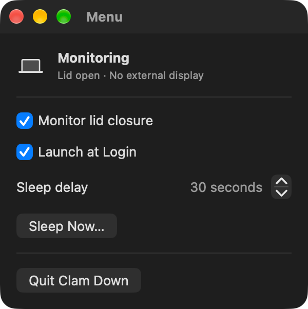
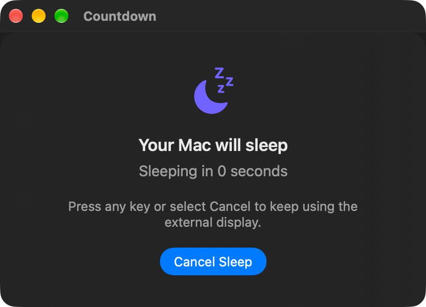

# ClamDown

  

ClamDown is a macOS menu bar app that shows a sleep countdown when you close the lid of a MacBook connected to an external display. Press any key or select **Cancel Sleep** during the countdown to keep your Mac awake.

## Features

- Detects MacBook lid closure and external display connections
- Shows the countdown above full-screen apps and across Spaces
- Provides a configurable sleep delay from 5 to 120 seconds
- Cancels sleep with any keyboard input or the **Cancel Sleep** button
- Starts a countdown on demand with **Sleep Now…**
- Optionally launches automatically when you log in
- Remembers monitoring, login, and delay preferences

## Requirements

- macOS 14 or later
- A MacBook
- An external display for automatic lid-closure detection

## Install and launch

1. Download and unzip `ClamDown.app`.
2. Move `ClamDown.app` to your **Applications** folder.
3. Open ClamDown from **Applications**.
4. Select the clam icon that appears in the macOS menu bar.

ClamDown is a menu bar app, so it does not appear in the Dock. If macOS blocks the first launch, Control-click `ClamDown.app`, choose **Open**, and confirm that you want to open it.

## Usage

### Configure ClamDown

  

1. Select the clam icon in the menu bar.
2. Turn on **Monitor lid closure**.
3. Set **Sleep delay** to a value between 5 and 120 seconds.
4. Optionally turn on **Launch at Login**.

### Start sleep automatically

With an external display connected, close the MacBook lid. ClamDown presents the countdown on the external display and puts the Mac to sleep when the timer reaches zero.

### Cancel sleep

During the countdown, either press any key or select **Cancel Sleep**.

  

### Start a countdown manually

Select **Sleep Now…** in the menu bar popover to start a countdown using the current delay without closing the lid. This is also a convenient way to test your settings.

### Pause monitoring

Turn off **Monitor lid closure** to prevent automatic countdowns. Doing so also cancels an active countdown.

## Important notes

- When the countdown finishes, your Mac will actually go to sleep.
- The panel may briefly reposition after lid closure while macOS updates the display and Space configuration.
- You may not see the countdown if the external display turns off or disconnects.

## Project structure

- `ClamDownModel.swift`: App state, lid detection, preferences, and countdown management
- `SystemMonitor.swift`: Lid, external display, keyboard, and system sleep integration
- `CountdownPanelController.swift`: Countdown panel displayed above full-screen Spaces
- `ContentView.swift`: Menu bar popover and countdown interface
- `MyApp.swift`: App entry point and menu bar setup

## License

ClamDown is available under the [MIT License](LICENSE). You may use, modify, and distribute it subject to the license terms.
